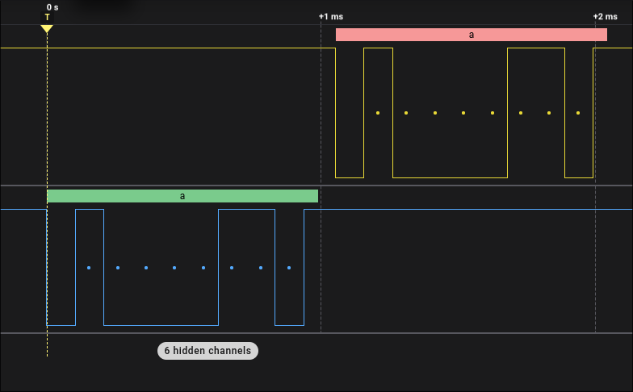

# ShmerV

ShmerV is a five-stage RISC-V CPU and small SoC written in SystemVerilog.
It runs bare-metal C firmware on a Tang Nano 9K FPGA, with GPIO, interrupts,
bidirectional UART, and HDMI text output.

## Why I built it

I started building CPUs with [SH8](https://github.com/Shmerlard/SH8), a
Logisim design with my own instruction set and assembly language. I also
built a [MIPS CPU in VHDL](https://github.com/Shmerlard/vhdl_final_project)
on an FPGA for a university project. With ShmerV, I wanted to keep going,
choose what to implement myself, and use an ISA with tools that let me
write more than assembly programs.

I wanted to learn SystemVerilog and understand more of what happens between
RTL, synthesis, and a working FPGA. RISC-V also lets me use an existing
assembler and C compiler, so the project extends into firmware as well as
computer architecture.

## Current implementation

- Five-stage `IF/ID/EX/MEM/WB` pipeline with RV32I arithmetic, branches,
  jumps, and byte, halfword, and word memory accesses.
- Forwarding, load-use stalls, and pipeline flushing.
- Initial Machine-mode trap handling, CSR access, and `MRET`.
- 16 KiB of block RAM on the Tang Nano 9K.
- Three eight-bit GPIO ports and interrupts.
- UART TX/RX with selectable
  9600, 19200, 57600, and 115200 baud rates.
- 640×480 HDMI text output with 80×30 cells, an 8×16 font, and 16 colors.
- Bare-metal startup code, linker scripts, and C programs for LED patterns,
  DIP-switch input, button interrupts, UART output, and polling/interrupt-driven echo.

The CPU core is separate from the SoC peripherals and board-specific wrapper.
UART uses eight-bit, LSB-first frames without parity. Polling and RX
interrupt-driven echo have been tested on the FPGA at 9600 baud.

## Future Work

Next steps are completing exception/CSR verification and adding official
RISC-V architectural tests. I plan configurable board targets, HDMI control
registers and cursor support, and terminal input handling in firmware.
I also want to simplify the build tools and write a short tutorial with
architecture and timing diagrams.

## Examples

### UART echo on hardware

The capture below shows the letter `a` arriving on RX (lower trace) and being
echoed back on TX (upper trace). UART uses C.0 for TX and C.1 for RX.



### HDMI hello world — WIP

Video placeholder: `hello world!` appearing one character per second.

### UART to HDMI — WIP

Video placeholder: terminal input appearing on the connected display.

### Pipeline execution — WIP

Waveform placeholder: a short instruction sequence showing forwarding and stalls.

## Verification

SystemVerilog testbenches run in Verilator at module and CPU-system level.
Software tests check register and memory results against values generated by
Spike from the same ELF. SoC-specific tests use explicit expected results
because Spike does not model the custom GPIO interrupts. Traced simulations
can be inspected in Surfer.

Exception and CSR verification is incomplete; this is not yet a fully
verified RV32I implementation. Official architectural tests are still pending.

## Quick Start

The project is developed on NixOS. The Nix flake provides the development
tools for `x86_64-linux`; Nix with flakes enabled is required for this setup.
Clone the repository and enter the development environment:

```sh
git clone https://github.com/Shmerlard/ShmerV.git
cd ShmerV
nix develop
```

Common commands:

```sh
just help                         # List available commands
just test                         # Run every test
just test alu                     # Run one module test
just test cpu_system basic        # Run one CPU software test
just test cpu_system -l           # List CPU software tests
just sim alu                      # Run with tracing and open Surfer
just sim cpu_system basic         # Trace one CPU software test
just sim cpu_system basic --elf   # Also open the ELF disassembly
just wave alu                     # Reopen an existing waveform
just wave cpu_system basic        # Reopen a CPU waveform
```

Maintenance commands:

```sh
just format
just format-check
just lint
```

## Running on the FPGA

There are two FPGA workflows, Gowin IDE (recommended for the current board
target) and Yosys/nextpnr; see the [board build commands](fpga/tang_nano_9k/cpu_system/README.md)
for loading firmware, wiring, and constraints. This workflow documentation
is WIP and will be reorganized.

## Repository layout

- `rtl/` contains the hardware.
- `tb/` contains SystemVerilog testbenches and persistent Surfer layouts.
- `tb/cpu/programs/<program>/` contains test-only assembly or C programs and human-written `.checks` files.
- `sw/programs/` contains bare-metal programs intended to run on the FPGA system.
- `build/` contains generated programs, logs, test executables, expected values, and waveforms.

See [Project structure](docs/project-structure.md) for directory ownership and
the FPGA/software relationship.

## License

[MIT](LICENSE).

## Credits

See [third-party credits and license notices](docs/third-party.md), including
VileR's `NICER40C` font, which is excluded from the project's MIT license.
